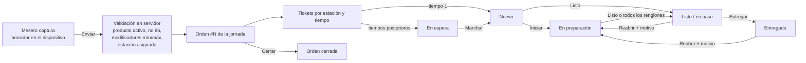

# 2. Flujos de principio a fin, permisos y excepciones

## 2.1 Flujo de comanda



**Reglas clave**

1. **Idempotencia.** Cada acción lleva un `op_id` (UUID) generado en el dispositivo; la orden y sus líneas también traen su propio id. Si una respuesta se pierde y se reintenta, el servidor devuelve el mismo resultado sin repetir efectos. *Probado:* prueba E2E "si se pierde la respuesta del servidor…" y SQL §1.
2. **Una línea enviada no se edita.** Se anula (con motivo) y se crea otra marcada **CAMBIO** que cocina ve resaltada.
3. **Ruteo.** Cada producto va a una o varias estaciones; un producto puede tener componentes (p. ej. *Hamburguesa → Parrilla*; *papas → Freidora*). Cada envío crea tickets nuevos (rondas).
4. **Tiempos (cursos).** Se puede enviar "tiempo 1 y retener el resto"; los tickets retenidos quedan *En espera* hasta **Marchar**. El cronómetro empieza al marchar.
5. **Jornada.** La primera orden abre la jornada del *día de negocio* (zona horaria + hora de corte, p. ej. 05:00). Configurable para exigir apertura manual. Cerrar con pendientes exige nota.
6. **Cobro.** Fuera del alcance actual: "Cerrar orden" marca la orden como terminada; el cobro ocurre en la caja del restaurante. [P: flujo de cobro/POS].

### Lenguaje de cocina ("vender ticket", "on sale")

[P] Pendiente confirmar con David qué significan exactamente "vender ticket" y "on sale" en su cocina. Para no fijar estados equivocados:

- Los **estados internos** son estables: `en_espera`, `nuevo`, `en_preparacion`, `listo`, `entregado`, `anulado`.
- Las **etiquetas visibles** y los textos de los botones (marcar listo, entregar) se configuran por restaurante en *Administración → Restaurante → Lenguaje de cocina*. Si "vender" = despachar al cliente, basta poner "Vender" como texto del botón de entrega.
- Si "on sale" fuese un estado intermedio real (p. ej. "en el pase esperando mesero"), corresponde al estado `listo` ("Listo / en pase").

## 2.2 KDS: tiempos, avisos y estados de pantalla

| Concepto | Regla |
|---|---|
| Tiempo objetivo del ticket | Máximo `prep_minutes` de sus productos. |
| Cronómetro activo | Desde que se marchó hasta listo, **menos el tiempo bloqueado por faltante**. |
| Espera | Desde marchado hasta "Iniciar". |
| Aviso progresivo | `A tiempo` → `Atención` (≥ 75 % del objetivo) → `Tarde` (≥ 100 %). Configurable. Siempre con **texto**, no solo color. |
| Faltante | "Reportar faltante" bloquea el ticket (sigue visible), crea incidencia y pausa el cronómetro activo. |
| Prioridad | Requiere permiso `orders.priority` o PIN de gerente; queda registrado quién autorizó. |
| Parcial | Tocar un renglón lo marca listo; cuando todos están listos, el ticket pasa a listo. |
| Recall | "Recientes" (45 min) permite reabrir con motivo y elegir si **se vuelve a preparar** (reproceso, consume inventario) o solo se marcó por error. |
| Cola vacía | Mensaje claro + cuántos se terminaron recientemente. |
| Saturación | Banner cuando hay ≥ 12 tickets en cola o ≥ 5 tarde. |
| Desconexión | Banner rojo con antigüedad de los datos y "tus acciones se guardan". Indicador permanente: tiempo real / sondeo / sin conexión / enviando N / N con error. |
| Ticket nuevo | Destello visual siempre + sonido opcional. |
| Bump‑bar / teclado | `1–9` selecciona, `Enter` = listo, `I` = iniciar, `R` = recientes. |

**Indicadores de equipo en el KDS:** % de tickets a tiempo en la jornada vs. meta (configurable, 85 % por defecto), listos, reprocesos y carga (puntos de complejidad en cola). **No hay clasificación individual** [H: evitar incentivos punitivos].

## 2.3 Excepciones y cómo se resuelven

| Situación | Qué pasa |
|---|---|
| Se cae internet al enviar una orden | Queda en la cola del dispositivo ("Por sincronizar"); se reintenta sola con espera creciente y al volver la red. Nunca se duplica. |
| Se cae internet en cocina | El KDS sigue mostrando lo último, aplica tus acciones de inmediato (marcadas "Sincronizando") y las envía en orden al reconectar. Al reconectar recarga todo para recuperar lo que se perdió por tiempo real. |
| La tableta se reinicia sin internet | La app abre desde caché (service worker) con la última sesión, datos y cola. |
| Dos cocineros marcan listo el mismo ticket | El segundo es "sin cambios"; un solo evento en historial. |
| Acción rechazada por el servidor (p. ej. permiso, ticket ya anulado) | La operación queda "con error" en el panel de sincronización con el motivo; se puede reintentar (con el PIN actual) o descartar. Nunca se descarta en silencio. |
| PIN vencido con acciones en cola | Error visible "sesión terminó"; al volver a ingresar PIN, "Reintentar" usa el nuevo token. |
| Producto agotado (86) | No se puede agregar; aparece "86 · Agotado". Lo que ya estaba en cola no se toca. |
| Anular algo ya preparado | Requiere gerente; inventario lo registra como **merma por anulación** (no regresa a existencia). |
| Mesero intenta operar orden ajena | Rechazado salvo permiso `orders.edit_any` o transferencia por gerente. |
| Cerrar orden con platillos sin entregar | Se avisa; se puede forzar con confirmación explícita. |
| Turno sin salida | La siguiente entrada (>18 h) se permite y genera incidencia para corrección. |
| Marca de asistencia sin conexión | Se guarda con la hora del dispositivo; el servidor la acepta si cae dentro de la sesión de PIN (ventana de 12 h) y la marca "sin conexión" para revisión. |

## 2.4 Matriz de permisos

| Permiso | Admin | Gerente | Cocinero | Mesero | Dispositivo (lectura) |
|---|:-:|:-:|:-:|:-:|:-:|
| `config.manage` restaurante y estaciones | ✅ | | | | |
| `staff.manage` personal, PIN, solicitudes | ✅ | | | | |
| `devices.manage` | ✅ | | | | |
| `menu.manage` menú, modificadores, importación | ✅ | | | | |
| `menu.86` disponibilidad | ✅ | ✅ | ✅ | | |
| `service.open_close` jornada | ✅ | ✅ | | | |
| `orders.create` capturar/enviar/entregar propias | ✅ | ✅ | | ✅ | |
| `orders.edit_any` / `orders.close_any` / transferir | ✅ | ✅ | | | |
| `orders.view_all` | ✅ | ✅ | | ✅ | pase, terminal |
| `orders.void_sent` anular lo enviado | ✅ | ✅ | | | |
| `orders.priority` | ✅ | ✅ | | | |
| `kds.view` | ✅ | ✅ | ✅ | ✅ (avance) | cocina, pase, terminal |
| `kds.bump` iniciar / listo | ✅ | ✅ | ✅ | | |
| `kds.reopen` reabrir con motivo | ✅ | ✅ | ✅ | | |
| `kds.block` faltante | ✅ | ✅ | ✅ | | |
| `inventory.view` (sin costos) | ✅ | ✅ | ✅ | | |
| `inventory.view_cost` | ✅ | ✅ | | | |
| `inventory.receive` | ✅ | ✅ | | | |
| `inventory.waste` / `inventory.produce` / `inventory.count` | ✅ | ✅ | ✅ | | |
| `inventory.approve_count` / `inventory.adjust` | ✅ | ✅ | | | |
| `inventory.manage` insumos y recetas | ✅ | | | | |
| `labels.print` | ✅ | ✅ | ✅ | | |
| `labels.reprint` (duplicar/anular) | ✅ | ✅ | | | |
| `labels.manage` formatos y vida útil | ✅ | | | | |
| `schedule.manage` / `attendance.manage` | ✅ | ✅ | | | |
| `attendance.self` | ✅ | ✅ | ✅ | ✅ | reloj |
| `reports.view` / `audit.view` | ✅ | ✅ | | | |
| `incidents.create` / `incidents.manage` | ✅/✅ | ✅/✅ | ✅/ | ✅/ | |

**Cómo se hace cumplir:** la base de datos (RLS + funciones con verificación de permiso). La interfaz solo oculta lo que no aplica; aunque alguien manipule la app, el servidor rechaza. *Probado:* SQL §6 y E2E "roles".

**Autorización en sitio:** si alguien sin permiso intenta una acción, puede pedir el PIN de un gerente presente; se emite un pase de **un solo uso, 10 minutos, para ese permiso**, y queda registrado quién autorizó.

**Decisiones de permisos a validar en el piloto** [P]:
- ¿El cocinero puede marcar 86 por sí mismo? (hoy sí; es lo habitual en cocina).
- ¿El cocinero puede reabrir? (hoy sí, con motivo obligatorio; queda en reportes).
- ¿El mesero ve órdenes de otros? (hoy sí, solo lectura; puede limitarse).

## 2.5 Flujos de personal

```mermaid
sequenceDiagram
  participant P as Persona
  participant R as Reloj (kiosko)
  participant S as Servidor
  participant G as Gerente
  P->>R: PIN
  R->>S: rpc_device_login (límite 5 intentos/10 min)
  S-->>R: sesión de 2 min + estado (última marca, turno de hoy)
  P->>R: Registrar entrada / descanso / salida
  R->>S: rpc_punch (op_id, hora del dispositivo)
  Note over S: valida secuencia; si llega tarde (sin red) la marca como "sin conexión"
  P->>S: "Olvidé marcar" (corrección)
  G->>S: Aprueba (no puede ser la misma persona)
  Note over S: anula/agrega marcas; las originales nunca se borran
```

Cambios de turno: la persona ofrece su turno (a alguien o a quien lo tome) → un compañero acepta → el gerente aprueba (se valida que no se empalme).
