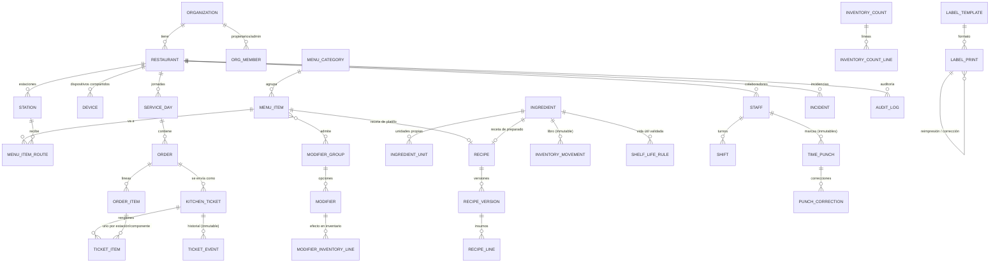

# 3. Modelo de datos: entidades, relaciones y reglas

Todas las tablas de negocio tienen `restaurant_id`. Un disparador (`app.check_same_restaurant`) impide relacionar registros de restaurantes distintos.

## Entidades y reglas

| Entidad (tabla) | Propósito | Reglas importantes |
|---|---|---|
| Organización (`organizations`, `org_members`) | Empresa/grupo; varios restaurantes. | El creador es *propietario*: administra todos sus restaurantes. |
| Restaurante (`restaurants`) | Sucursal. Zona horaria, hora de corte, moneda, ajustes. | Zona horaria validada. Código de unión y "pimienta" de PIN en `app.restaurant_secrets` (no expuesto). |
| Persona (`staff`, `staff_private`) | Colaborador con 1–4 roles. Contacto aparte. | Puede no tener cuenta (solo PIN). Nadie cambia sus propios roles. Vincular cuenta solo vía solicitud aprobada. |
| PIN (`app.staff_pins`) | HMAC‑SHA256 del PIN con secreto del restaurante. | Único por restaurante; nunca en claro; nunca expuesto por API ni tiempo real. |
| Dispositivo (`devices`, `app.device_sessions`) | Cuenta de tableta/terminal/reloj con modo y estación. | Operar exige token de operador (sesión por PIN, 12 h; reloj 2 min). |
| Estación (`stations`) | Parrilla, comal, barra, pase… | Desactivar en vez de borrar si tiene historial. |
| Producto de menú (`menu_items`, `menu_item_routes`) | Lo que se vende; a qué estaciones va. | Debe tener ≥ 1 estación para venderse. `prep_minutes` y `complexity` alimentan avisos e indicadores. `available=false` = 86. |
| Modificador (`modifier_groups`, `modifiers`) | Opciones con mín./máx. y precio extra. | Se valida en servidor al capturar. El texto de cocina ("SIN CEBOLLA") se resalta. |
| Jornada (`service_days`) | Día de negocio y numeración de órdenes. | Una abierta por restaurante. |
| Orden (`orders`, `order_items`) | Comanda y sus líneas (instantánea de nombre, precio y modificadores). | Id generado por el dispositivo. Línea: `pendiente → enviado → anulado`. Anulación con motivo, actor y autorizador. |
| Ticket (`kitchen_tickets`, `ticket_items`) | Lo que ve cada estación por envío y tiempo. | Estados y transiciones validadas en servidor; `version` y `updated_at` para refresco. |
| Transición (`ticket_events`) | Historial: acción, de→a, motivo, nota, actor, dispositivo, autorizó, op_id. | **Inmutable** (no se edita ni borra). |
| Insumo (`ingredients`, `ingredient_units`, `ingredient_costs`) | Materia prima o preparado. Unidad base g / ml / pza. | Unidad base bloqueada si hay movimientos. Costo aparte (solo gerencia). |
| Unidad (`units`) | Estándar: g, kg, mg, lb, oz, ml, l, floz, gal, taza, cda, cdita, pza, docena. | Conversión solo dentro de la misma dimensión; entre dimensiones solo con unidad propia del insumo ("tortilla = 30 g"). |
| Receta (`recipes`, `recipe_versions`, `recipe_lines`) | Platillo o preparado. | Una versión activa; las activas/retiradas no se editan; el consumo guarda la versión usada. Preparados exigen rendimiento. Sin autorreferencia. |
| Movimiento (`inventory_movements`) | Libro de inventario. | **Inmutable.** Signo según tipo. Llave única por origen → imposible descontar dos veces. `effective_at` permite que el ajuste de conteo aplique al momento del conteo. |
| Conteo (`inventory_counts`, `inventory_count_lines`) | Existencia física. | abierto → enviado → aprobado. Aprobar fija teórico al momento del conteo y genera ajuste por diferencia (una sola vez). |
| Producción (`production_batches`) | Tanda de preparado. | Entra el preparado, salen sus insumos escalados por rendimiento. |
| Etiqueta (`label_templates`, `shelf_life_rules`, `label_prints`) | Formato, vida útil validada, impresiones. | Lote `AAMMDD-NNN` por día. Reimpresión = mismo lote enlazado. Corrección = anula y emite nueva enlazada. |
| Turno (`shifts`) | Programación. | Sin empalmes por persona (restricción de exclusión). Máx. 16 h. Borrador invisible al equipo hasta publicar. |
| Disponibilidad, ausencias, cambios (`staff_availability`, `time_off_requests`, `shift_swap_requests`) | Solicitudes. | Nadie se aprueba a sí mismo. Cambio requiere aceptación del compañero y aprobación. |
| Asistencia (`time_punches`, `punch_corrections`) | Marcas y correcciones. | Secuencia válida. Marcas inmutables (solo se anulan con corrección aprobada). |
| Incidencia (`incidents`) | Faltantes, equipo, impresora, calidad. | Se crean solas al bloquear un ticket o al fallar una impresión. |
| Auditoría (`audit_log`) | Cambios de configuración. | Automática por disparador; antes/después, quién, cuándo. |
| Idempotencia (`app.processed_ops`) | Resultado de cada `op_id`. | Limpieza a 30 días con `app.housekeeping()`. |

## Multisitio

[D] Ya soportado: una organización con varios restaurantes; una persona puede pertenecer a varios (elige al entrar). Cada restaurante tiene su menú, inventario y personal. [P] Pendiente: menú/recetas compartidos entre sucursales, transferencias de inventario y reportes consolidados.
